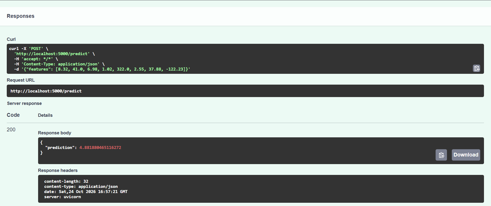

# California Housing Price Predictor

## Problem Description
This project predicts the median house value for California districts
based on 8 features (median income, house age, average rooms, etc.).
It is a regression task — the output is a number representing the median
house value in units of $100,000. Useful for real-estate valuation
and market analysis.

## Dataset
California Housing dataset (built into scikit-learn). 20,640 rows,
8 features, 1 target (`MedHouseVal`). No missing values.

## EDA Summary
- No missing values in the dataset
- `MedInc` (median income) is the strongest predictor of house value
- Correlation heatmap included in `notebook.ipynb`

## Models Trained
Two models were compared:
1. Linear Regression — RMSE ≈ 0.7456
2. Decision Tree (max_depth=6) — RMSE ≈ 0.7052

**Best model: Decision Tree** (lower RMSE), saved as `model.joblib`.

## Deployment
A FastAPI service exposes the trained model as a REST API.

### Run locally
```bash
pip install -r requirements.txt
python train.py           # trains and saves model.joblib
python -m uvicorn predict:app --host 0.0.0.0 --port 5000

```

### Test
Open http://localhost:5000/docs for the interactive Swagger UI.

Or via curl:
```bash
curl -X POST http://localhost:5000/predict \
  -H "Content-Type: application/json" \
  -d '{"features": [8.32, 41.0, 6.98, 1.02, 322.0, 2.55, 37.88, -122.23]}'
```

Response:
```json
{"prediction": 4.24}
```

### Deployment proof


## Docker
The `Dockerfile` packages the API and model into a container:
```bash
docker build -t midterm .
docker run -p 5000:5000 midterm
```

## Files
- `notebook.ipynb` — EDA and model experimentation
- `train.py` — reproducible training script → `model.joblib`
- `predict.py` — FastAPI service
- `requirements.txt` — dependencies
- `Dockerfile` — container definition
- `screenshot-prediction.png` — deployment proof